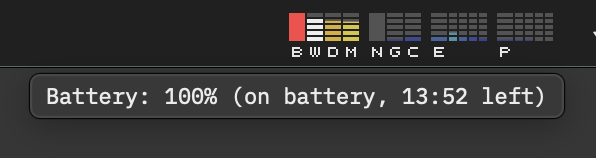
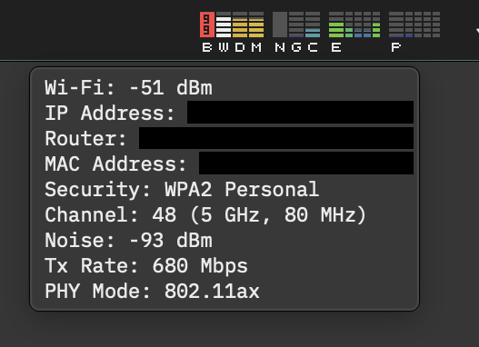
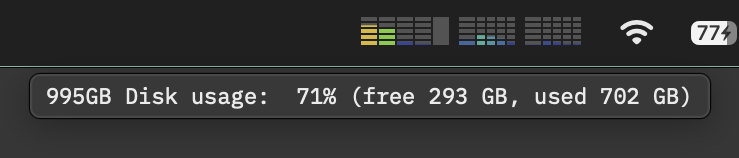
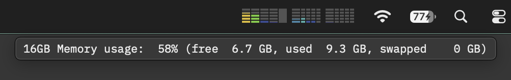
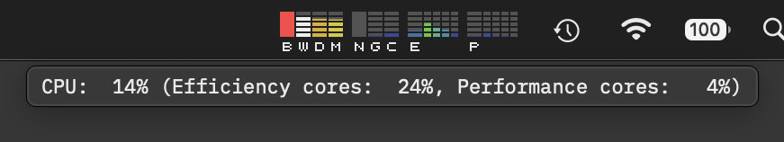
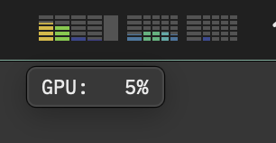
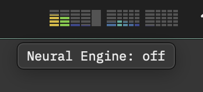
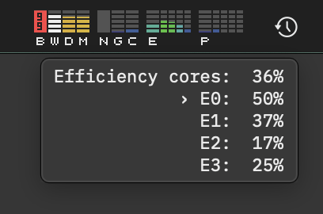
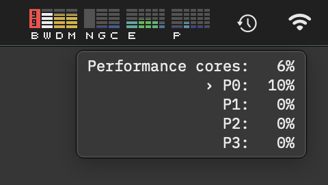

# cpuTopBars

A lightweight CPU monitoring tool designed specifically for the macOS menu bar. Keep a pulse on your system performance without cluttering your workspace.

If you use the macOS Battery and Wi-Fi menu-bar items mainly to check their status, cpuTopBars can take their place: its battery and Wi-Fi bars and their hover labels show the battery's charge and whether it is charging, and the Wi-Fi signal and connection details, so you can hide those items in System Settings and free up menu-bar space. It does not replace them entirely; among other things, it has none of their controls (it cannot join a network, turn Wi-Fi on or off, or change power settings), and it does not show the network's name.

* **hiding in the menu bar:**

* **showing settings, readings and processes:**

## 🚀 Features

`cpuTopBars` provides real-time insights into your system's CPU usage with a focus on aesthetics and customization.

* **Real-time Menu Bar Visualization:** View your CPU activity at a glance with a live-updating graph right in your macOS menu bar, beside small bars, in this order, for the battery (on a Mac with one: a bar filled to its charge, red on battery, green while it charges and white (black on a light menu bar) while plugged in and not charging, with the charge in percent written down it below 100%), the Wi-Fi signal (five segments), disk and memory use, then after a small gap the Neural Engine (its busy share in the version built from this repository, whether it is powered on in the App Store versions), GPU use and overall CPU use, then bars for the efficiency cores' and the performance cores' use, each of these two heading its own cores' bars when the graph shows each core and the Mac lists its efficiency cores first, and under each of these bars its letter: B battery, W Wi-Fi, D disk, M memory, N Neural Engine, G GPU, C CPU, E and P the efficiency and performance cores (switchable in Settings: one switch turns off the disk, memory, CPU, E-core and P-core bars and with them the other wide bars and the letters, leaving the core bars; three more switch the battery and Wi-Fi bars, the GPU and Neural Engine bars, and the letters).
* **Top Process Tracking:** Quickly identify which of your processes are consuming the most CPU with a ranked list of processes, titled "TOP PROCESSES BY CPU" in the version built from this repository and "YOUR TOP PROCESSES BY CPU" in the App Store versions, each with its CPU share and, for your own processes, its memory (physical footprint, in GB); in the version built from this repository the list ranks other users' processes too, among them macOS's system daemons and WindowServer; in the App Store versions they are counted in one row below it.
* **System readings:** when the menu opens, a panel beside it shows uptime, the battery's charge and whether it is charging, Wi-Fi's signal while connected (else whether it is on), then startup-volume, memory and overall CPU usage as percentages with their sizes, the disk and memory with their free and used space, memory with its swap in use and CPU with its efficiency and performance cores' use, GPU use (with its power in watts in the version built from this repository) and the Neural Engine's busy share (in the App Store versions, whether it is powered on), all read on the Mac; nothing is sent over the network.
* **Hover labels:** rest the pointer on a bar for a second to see its value below the menu bar; on the core bars it lists each core's load, and on the Wi-Fi bar, while connected, the details the macOS Wi-Fi menu shows with the Option key held (IP address, router, MAC address, security, channel, noise, transmit rate and PHY mode; not the network's name, so no Location Services permission is asked).
* **Process inspector:** click a process in the menu to open a window with its man page, where it has one, and its arguments and environment; in the version built from this repository also its open files (lsof), its symbols (nm) and a sample of its stacks (sample), and a Kill button for your own processes.
* **Freeze:** pause the process list to examine it while the CPU graph keeps running; while frozen, rest on a ↳ row to see what it is a helper of.
* **Launch at login:** turn it on in Settings to open cpuTopBars when you log in.
* **How to Read the Menu Bar:** a window, opened from the menu, that explains the bars and their colours, with drawn examples.
* **Support Team Fox:** a menu row that opens halfmarble's Team Fox fundraising page in your browser.
* **Customizable:** Settings opens with a Demo group that previews the menu-bar graph live, on a sine wave and on a flat wave.
    * **Refresh Rates:** Choose between 2, 5, or 10 updates per second for ultra-responsive feedback (5 by default).
    * **Top Processes:** Show 3, 5, 10 or 15 processes in the menu (5 by default).
* **System Integration:** One-click access to the macOS native **Activity Monitor**.

## 🔎 Hover Labels

Rest the pointer on a bar for a second and its reading shows below the menu bar.

* **Battery:** the battery's charge, and whether it is charging, not charging, charged, or on battery, with the time left when macOS gives one.

* **Wi-Fi:** while connected, the signal, then the IP address, router, MAC address, security, channel, noise, transmit rate and PHY mode; else whether Wi-Fi is off or not connected. In the picture the addresses are blacked out.

* **Disk:** the startup volume's use, with its free and used space.

* **Memory:** memory in use, with free, used and swapped memory.

* **CPU:** overall CPU use, with the efficiency and performance cores' use.

* **GPU:** the GPU's use.

* **Neural Engine:** the Neural Engine's busy share (in the App Store versions, whether it is powered on).

* **Efficiency cores:** their use, then each efficiency core's load; › marks the core under the pointer.

* **Performance cores:** the same for the performance cores.

## 🛠 Installation

A Mac App Store release is coming. Until then, build it from source:

1.  Clone this repository and open `cpuTopBars.xcodeproj` in Xcode.
2.  Choose **Product > Run**.
3.  Look for the activity graph in your menu bar!

cpuTopBars requires macOS 27 or later.

cpuTopBars was called upMonitor; release 1.0 on GitHub is that old app. A copy you built from source under the old name keeps its own settings and its own login item, which still opens that copy at login: turn Launch at login off in the old copy, or delete it, then set your settings and Launch at login again in cpuTopBars, which starts with the default settings.

The version you build from this repository runs outside the App Sandbox. It ranks every user's processes (WindowServer, kernel_task, system daemons) in the list; it gives the inspector lsof, nm and sample tabs and a Kill button for your own processes, and shows the Neural Engine's busy share and the GPU's power in watts. The App Store versions are sandboxed: the sandbox gives an app no CPU figures for other users' processes and does not let it run those tools or signal other processes, and the counters behind the Neural Engine's share and the GPU's watts are left out of those versions. So they list your own processes, count the others in one row, show no extra inspector tabs and no Kill button that signals the process from the app (devTopBars, the paid App Store app below, runs a Shortcut you add once instead), and show the Neural Engine as on or off. The Neural Engine's share and the GPU's watts come from counters Apple does not document; they were checked on one Mac (an M3), and where they cannot be read the Neural Engine shows on or off and the GPU shows its use alone.

## 🛍 App Store Versions

Two apps are coming to the Mac App Store: **cpuTopBars**, free, and **devTopBars**, a paid app built on cpuTopBars with more features. Both run in the App Sandbox, and devTopBars adds features of its own; the table shows how they differ from the version you build from this repository:

| | Built from this repository | cpuTopBars (App Store, free) | devTopBars (App Store, paid) |
|---|---|---|---|
| **Source** | open, MIT, this repository | this repository's code, built in the App Sandbox | closed, built on this repository's code |
| **App Sandbox** | no | yes | yes |
| **Process list** | "TOP PROCESSES BY CPU": every user's processes, among them system daemons and WindowServer | "YOUR TOP PROCESSES BY CPU": your own processes, the others counted in one row | as in cpuTopBars from the App Store |
| **Inspector tabs** | man page, arguments and environment, lsof, nm, sample | man page, arguments and environment | man page, arguments and environment |
| **Ending a process** | a Kill button for your own processes | none | Kill through a Shortcut you add once, or copy the process's name and open Activity Monitor |
| **Neural Engine** | its busy share, where it can be read | on or off | on or off |
| **GPU** | its use, and its power in watts where it can be read | its use | its use |
| **Usage bars for an AI coding plan** | — | — | the plan's 5-hour and weekly limits, and one bar per live session, fed by a free open-source plugin |
| **IP addresses** | the Wi-Fi address and router, in the Wi-Fi bar's hover label | the same | the same, plus LAN, WAN and VPN rows in the menu; the WAN address is looked up only when you click its row |
| **Keep Mac awake** | — | — | while a chosen process runs, from the inspector |
| **Network use** | none | none | the WAN lookup when you click its row, and one check at launch for a newer plugin version, which you can turn off |

## ⚙️ Configuration

To customize your experience:
1.  Click on the `cpuTopBars` icon in the menu bar.
2.  Select **Open cpuTopBars Settings...**
3.  Adjust the settings to fit your workflow.

## 🤝 Contributing

Bug reports and ideas are welcome as GitHub issues.

Pull requests are welcome too; please keep each one to a single change.

## 📄 License

Distributed under the MIT License. See `LICENSE` for more information.

---
Created with ❤️ by [halfmarble](https://github.com/halfmarble)

halfmarble pledges **5% of software net profits** to charity — 2.5% to [Team Fox](https://give.michaeljfox.org/halfmarble), the grassroots fundraising program of The Michael J. Fox Foundation, and 2.5% to [Public Health Collaboration](https://phcuk.org/) (PHC). halfmarble is an independent Team Fox third-party fundraiser.
