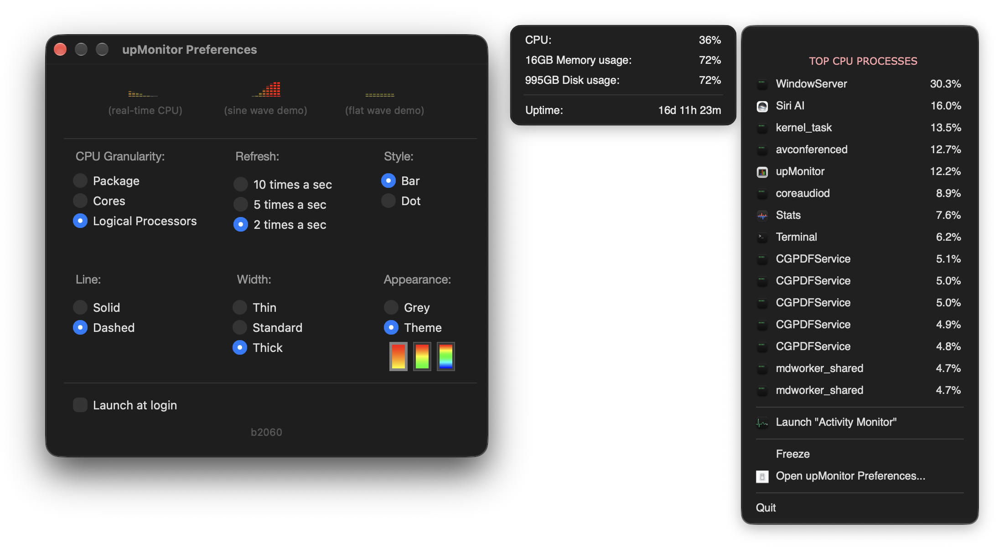

# cpuTopBars

A lightweight CPU monitoring tool designed specifically for the macOS menu bar. Keep a pulse on your system performance without cluttering your workspace.

* **hiding in the menu bar:**

* **showing settings, readings and processes:**

## 🚀 Features

`cpuTopBars` provides real-time insights into your system's CPU usage with a focus on aesthetics and customization.

* **Real-time Menu Bar Visualization:** View your CPU activity at a glance with a live-updating graph right in your macOS menu bar, beside small bars for disk, memory, overall CPU and GPU use, a dot that shows when the Neural Engine is powered on, and bars for the efficiency cores' and the performance cores' use, each of these two heading its own cores' bars when the graph shows each core and the Mac lists its efficiency cores first (switchable in Settings).
* **Top Process Tracking:** Quickly identify which of your processes are consuming the most CPU with a ranked list of "Your Top Processes by CPU"; processes of other users, among them macOS's system daemons and WindowServer, are counted in one row below it.
* **System readings:** when the menu opens, a panel beside it shows uptime, then startup-volume, memory and overall CPU usage as percentages with their sizes, the disk and memory with their free and used space, memory with its swap in use and CPU with its efficiency and performance cores' use, GPU use and whether the Neural Engine is powered on, all read on the Mac; nothing is sent over the network.
* **Freeze:** pause the process list to examine it while the CPU graph keeps running; while frozen, rest on a ↳ row to see what it is a helper of.
* **Launch at login:** turn it on in Settings to open cpuTopBars when you log in.
* **How to Read the Menu Bar:** a window, opened from the menu, that explains the bars and their colours, with drawn examples.
* **Customizable:**
    * **Refresh Rates:** Choose between 2, 5, or 10 updates per second for ultra-responsive feedback (5 by default).
    * **Top Processes:** Show 3, 5, 10 or 15 processes in the menu (5 by default).
* **System Integration:** One-click access to the macOS native **Activity Monitor**.

## 🛠 Installation

A Mac App Store release is coming. Until then, build it from source:

1.  Clone this repository and open `upMonitor.xcodeproj` in Xcode.
2.  Choose **Product > Run**.
3.  Look for the activity graph in your menu bar!

cpuTopBars requires macOS 27 or later.

cpuTopBars was called upMonitor; release 1.0 on GitHub is that old app.

cpuTopBars runs in the App Sandbox. The sandbox gives an app no CPU figures for other users' processes (WindowServer, kernel_task, system daemons), so the menu lists your own processes and counts the others in one row.

## ⚙️ Configuration

To customize your experience:
1.  Click on the `cpuTopBars` icon in the menu bar.
2.  Select **Open cpuTopBars Settings...**
3.  Adjust the settings to fit your workflow.

## 🤝 Contributing

Contributions are welcome! Whether it's reporting a bug, suggesting a feature, or submitting a pull request, feel free to get involved.

1.  Fork the Project
2.  Create your Feature Branch (`git checkout -b feature/AmazingFeature`)
3.  Commit your Changes (`git commit -m 'Add some AmazingFeature'`)
4.  Push to the Branch (`git push origin feature/AmazingFeature`)
5.  Open a Pull Request

## 📄 License

Distributed under the MIT License. See `LICENSE` for more information.

---
Created with ❤️ by [halfmarble](https://github.com/halfmarble)

halfmarble pledges **5% of software net profits** to charity — 2.5% to [Team Fox](https://give.michaeljfox.org/halfmarble), the grassroots fundraising program of The Michael J. Fox Foundation, and 2.5% to [Public Health Collaboration](https://phcuk.org/) (PHC). halfmarble is an independent Team Fox third-party fundraiser.
